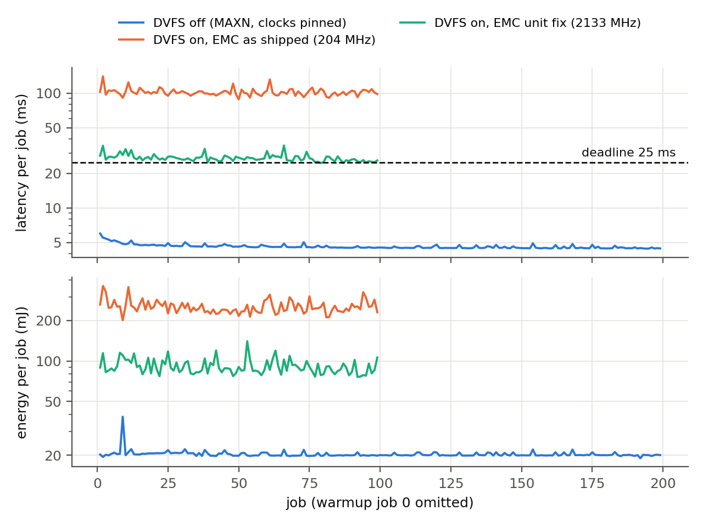

# NeuOS on Jetson AGX Xavier with JetPack 5 (L4T R35.4.1)

This folder records a test of whether the original NeuOS code (Caffe fork plus the `AGX/` overlay)
builds and runs on a current Jetson AGX Xavier software stack. The README says NeuOS was
tested on JetPack 4.3 (L4T 32.3.1, CUDA 10.0). Here it runs on JetPack 5.1.2, which brings CUDA 11.4,
cuDNN 8.6 and OpenCV 4.5.

**Result.** After small porting fixes, NeuOS builds and runs end to end with CaffeNet:

- **DVFS off.** The output matches stock Caffe exactly: on `examples/images/cat.jpg`, top-1 is
  "tabby cat" at 0.3134 and the other four classes and scores also match. Each inference takes
  4.55 ms (p50).
- **DVFS on.** The NeuOS controller runs and sets CPU, GPU, core-online and EMC knobs on the Xavier.
  It still misses the 25 ms deadline in almost every job, because the AGX build has no Xavier
  profile and these runs use the TX2 hash table instead.

Two bugs in the AGX code had to be fixed to get these results (details below):

1. A file-descriptor leak. The process runs out of fds after about 60 jobs.
2. A unit error on the memory clock. It pins EMC at its 204 MHz minimum.

All numbers come from single runs.

## Setup

| | |
|---|---|
| Board | Jetson AGX Xavier 32 GB (tegra194), NVMe at `/mnt/ssd` |
| Software | L4T R35.4.1 (JetPack 5.1.2), Ubuntu 20.04, kernel 5.10, CUDA 11.4, cuDNN 8.6.0, OpenCV 4.5.4, CMake 3.16.3, g++ 9.4 |
| Caffe deps | conda-forge env on the NVMe: libprotobuf 3.21, glog 0.5, gflags, Boost 1.74, lmdb, leveldb, snappy, HDF5, OpenBLAS. The eMMC root had < 600 MB free, so nothing was installed system-wide |
| Power mode | MAXN, with `jetson_clocks` applied before every run: CPU 2.27 GHz, GPU 1377 MHz, EMC 2133 MHz, all 8 cores online, fan PWM 229 |
| Model | BVLC CaffeNet (`bvlc_reference_caffenet.caffemodel`, sha1 matches `readme.md`) plus its low-rank twin from `models/lowrank/config.json` (rank 8/40/60/100/200 for conv1-5) |
| Input | `examples/images/cat.jpg`, deadline (`period`) 25 ms |
| DVFS tables | `examples/triangle/all-AGX.config` (51,968 configurations); hash table `hashtables/TX2/caffenet-cudnn-HASHTABLE.txt`, because the repository has no AGX table |
| Energy | energymon, from the INA3221 rails (SYS5V, GPU, CPU, VDDRQ) |

## Changes needed for JetPack 5

The DVFS-off result needs every change except the last two. The DVFS-on results need all of them.

| File | Change | Why |
|---|---|---|
| `src/caffe/layers/cudnn_conv_layer.cpp` | When cuDNN >= 8, choose algorithms with `cudnnGetConvolution*Algorithm_v7`, taking the fastest whose workspace fits the limit | cuDNN 8 removed `cudnnGetConvolution{Forward,BackwardFilter,BackwardData}Algorithm` |
| `cmake/Cuda.cmake` | Read the version from `cudnn_version.h` when it exists | cuDNN 8 moved the version macros; CMake stopped with "cuDNN version >3 is required" |
| `src/caffe/util/io.cpp` | `SetTotalBytesLimit` takes one argument when protobuf >= 3.6 | The two-argument form was removed |
| `src/caffe/util/io.cpp`, `layers/window_data_layer.cpp`, `test/test_io.cpp` | `CV_LOAD_IMAGE_*` → `cv::IMREAD_*` | These constants are gone in OpenCV 4 |
| `energymon/AGX/odroid/energymon-odroid.c` | Read INA3221 voltage and current through hwmon and compute V·I. Same four rails and units (mW); falls back to the old iio files | L4T R35 replaced `ina3221x/.../iio_device/in_powerN_input` with hwmon. Without this every reading failed (`Bad file descriptor`) and energy was 0 |
| `AGX/include/caffe/net.hpp`, `AGX/src/caffe/net.cpp` | Add `is_config_on` and `shutdown_config()`, as in the TX2 code: `warmup()` and the per-layer scheduling are skipped when DVFS is off | `classification.cpp` calls `shutdown_config()`, which the AGX overlay lacked, so `classify.bin` did not compile. Without the guard, `warmup()` indexes an empty configuration table; as root it would write an all-zero configuration to sysfs (CPU cores offline, 0 Hz) |
| `AGX/src/caffe/net.cpp` | Read the shm key files from `$NEUOS_SHM_DIR`, defaulting to `/home/nvidia` as before | Lets the code run without a `/home/nvidia` directory (README step 7) |
| `examples/triangle/classification.cpp` | Read `config_mode` from `argv[13]` (the 13th argument in the README) instead of `argv[11]` | `argv[11]` is the low-rank prototxt path, so `atoi` returned 0 and DVFS could never be turned on |
| `examples/triangle/build_xavier.sh` (new) | Builds `classify.bin` with this board's paths | The `Makefile` points at `/media/SSD/...` and `opencv` (not `opencv4`) |
| `AGX/include/DVFS/setconfig.h` | Close `force_idle` in `setGpuFreq()`, and close already-open files when one `fopen` fails | **fd leak.** Every GPU frequency change left one fd open. After about 60 jobs the process reached the 1024-fd limit (986 open `force_idle` handles). From then on, frequency writes and power reads failed silently and energy read as 0. The leaked run is kept in `results/fd_leak_run/` |
| `AGX/include/DVFS/setconfig.h` | `setEmcFreq()` treats values below 10^6 as MHz | **EMC unit error.** Every line of `all-AGX.config` sets memory to `2133`, but bpmp's `emc/rate` expects Hz. `warmup()` therefore asked for 2133 Hz and EMC sat at its 204 MHz floor for the whole run. The scheduler never changes EMC afterwards, because all configurations share the same value |

`models/lowrank/lowrank_approx.py` needs pycaffe (Python 2), which this build does not include.
`scripts/make_lowrank_weights.py` does the same per-group SVD split by reading and writing the
caffemodel protobuf directly. It also accepts the old V1 `layers` format of the BVLC CaffeNet
weights.

## Results



| Run | Jobs | p50 (ms) | p99 (ms) | Max (ms) | Over 25 ms | Mean energy (mJ/job) | Wall time per job (s) |
|---|---|---|---|---|---|---|---|
| DVFS off (MAXN, clocks pinned) | 199 | 4.55 | 5.42 | 5.99 | 0 (0%) | 20.3 | - |
| DVFS on, EMC as shipped (204 MHz) | 99 | 101.50 | 132.35 | 140.39 | 99 (100%) | 252.9 | 11.8 |
| DVFS on, EMC unit fix (2133 MHz) | 99 | 27.09 | 34.91 | 35.02 | 95 (96%) | 91.1 | 5.9 |

Notes on the table:

- **Latency and energy** are the values NeuOS prints per job (`xup_exec_us`, `xup_energy_mj`).
  Each one sums, over the network's layers, the layer time averaged over NeuOS' 20 repeats, plus
  the time `schedule()` takes. It is not wall time. The time spent applying the chosen
  configuration (core hotplug and sysfs writes) is not included.
- **Wall time per job** is the real time `classify.bin` spent per job: 20 repeats of every layer,
  plus the DVFS switches. It is dominated by CPU hotplug.
- **Job 0** is the warmup job and is left out. It takes about 59 ms in every run, because it
  includes cuDNN initialization.


| DVFS-on run | CPU median | GPU median | EMC | Online cores, median (min) | Max open fds |
|---|---|---|---|---|---|
| EMC as shipped | 2.04 GHz | 676 MHz | 204 MHz in 97% of samples | 5 (1) | 39 |
| EMC unit fix | 1.42 GHz | 676 MHz | 2133 MHz throughout | 5 (1) | 39 |

### What this shows

- **The port is correct when DVFS is off.** The `classification.cpp` code path with the early
  `return 0` removed (`/mnt/ssd/neuos/check` on the board; not committed) prints exactly the
  scores the Caffe docs list for this image and model:
  0.3134 tabby cat, 0.2380 tiger cat, 0.1235 Egyptian cat, 0.1003 red fox, 0.0715 lynx. So the
  `_v7` algorithm choice in cuDNN 8 does not change the results.
- **NeuOS' controller works on the Xavier.** It reads the AGX configuration table, picks a
  configuration per layer, hotplugs cores and moves CPU, GPU and EMC clocks. With the two fixes it
  ran 100 jobs with a constant 36-39 open fds.
- **With the TX2 profile, NeuOS misses the deadline.** Even with EMC fixed, p50 is 27 ms and 96%
  of jobs exceed 25 ms. Each job uses 4.5 times the energy of the pinned-MAXN baseline
  (91 vs 20 mJ). The controller keeps the GPU around 676 MHz and the CPU around 1.4 GHz,
  where the baseline has 1377 MHz and 2.27 GHz. Its predictions come from the TX2's per-layer
  uncertainty values, which do not describe this board. A Xavier hash table would be needed
  (`hashtables/generate_hashtable.py` plus a profiling sweep) before these numbers say anything
  about NeuOS itself. The report does not separate how much of the per-job time is `schedule()`
  over the 51,968 configurations, because NeuOS does not log the two parts separately.
- **The EMC unit error matters.** With EMC stuck at 204 MHz, latency is 3.7 times higher
  (101.5 vs 27.1 ms) and energy 2.8 times higher. Any earlier AGX result run with this code and
  `all-AGX.config` should be checked for this, unless that L4T version's bpmp interpreted the value
  differently.

### Things not done

- No Xavier hash table and no AGX profiling, so no claim about NeuOS' real performance on this board.
- Only CaffeNet. No concurrent instances (`parallel.sh`), no other networks.
- `setClusterFreq`/`setGpuFreq` write `freq`, then `min`, then `max`. When the frequency goes up,
  the `min` write is rejected while the old `max` is still lower. This was not investigated; the
  clock trace shows the GPU does reach the higher frequencies.
- The prediction printout in `classification.cpp` still comes after `return 0`. It was left as it is.

## Board state

Before every DVFS-on run, `scripts/dvfs_run.sh` saved the board state (`jetson_clocks --store`
and `--show`, plus the modes of every file `enable-dvfs.sh` makes writable). Afterwards it
restored governors, cores, clocks, fan PWM and file modes.

`jetson_clocks --restore` did not finish the job twice:

- **After the fd-leak run**, it left the GPU at 676 MHz, EMC at 204 MHz and the CPU minimum at
  2.11 GHz, because NeuOS sets min = max.
- **After the run without the EMC fix**, EMC was still at 204 MHz.

Both times the board was put back with `jetson_clocks` and fan PWM 229, which is the state it
was in before the runs. The committed script now opens the GPU/CPU min/max ranges before
`--restore`. If the result then differs from the saved `--show` output, including current
clocks, it falls back to `jetson_clocks`.

After the last run the board matched its pre-run state: MAXN, `schedutil`/`nvhost_podgov`, all
cores online, CPU 2.27 GHz, GPU 1377 MHz, EMC 2133 MHz, fan PWM 229 (`results/jetson_clocks_*`).
NeuOS' SysV shm segments were removed.

## Files

| Path | Content |
|---|---|
| `scripts/build.sh` | Full build: conda deps, energymon, AGX overlay, Caffe, `classify.bin`, CaffeNet weights, low-rank weights |
| `scripts/make_lowrank_weights.py` | Low-rank caffemodel without pycaffe |
| `scripts/dvfs_run.sh` | DVFS-on run: save state, `enable-dvfs.sh`, sample clocks, run, restore. Paths are those used on the board (`/mnt/ssd/neuos`) |
| `scripts/plot_results.py` | Figures and tables in this README |
| `results/off_200.log` | DVFS off, 200 jobs (run as root so energymon can read the rails) |
| `results/dvfs_on.log`, `clocks_on.tsv` | DVFS on, EMC as shipped, 100 jobs |
| `results/dvfs_emcfix.log`, `clocks_emcfix.tsv` | DVFS on, EMC fix, 100 jobs |
| `results/fd_leak_run/` | First DVFS-on attempt, stopped after about 60 jobs when it ran out of fds |
| `results/board_state_before.txt`, `jetson_clocks_*`, `modes_*` | Board state before and after |

DVFS off:

```bash
sudo env NEUOS_SHM_DIR=/path/to/shm/dir ./classify.bin \
  models/bvlc_reference_caffenet/deploy.prototxt models/bvlc_reference_caffenet/bvlc_reference_caffenet.caffemodel \
  data/ilsvrc12/imagenet_mean.binaryproto data/ilsvrc12/synset_words.txt examples/images/cat.jpg \
  200 25 5 all-AGX.config hashtables/TX2/caffenet-cudnn-HASHTABLE.txt \
  models/lowrank/caffenet_lowrank_deploy.prototxt models/lowrank/caffenet_lowrank.caffemodel 0
```

Give absolute paths. Set the last argument to `1` for DVFS on, after running `power-utility/AGX/enable-dvfs.sh` as root.
