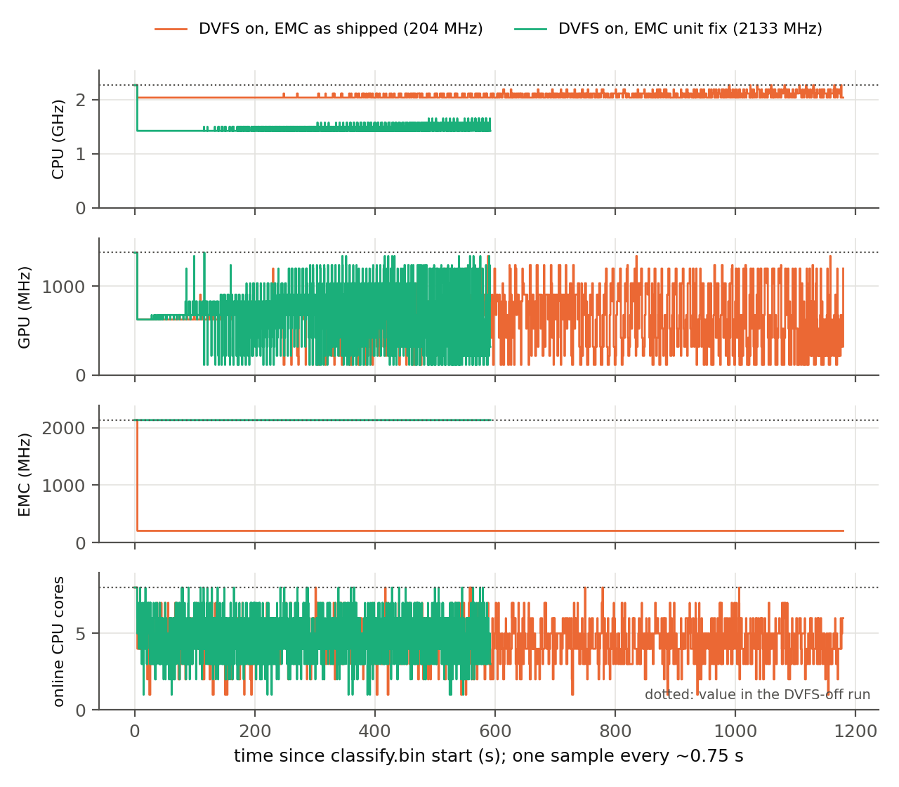
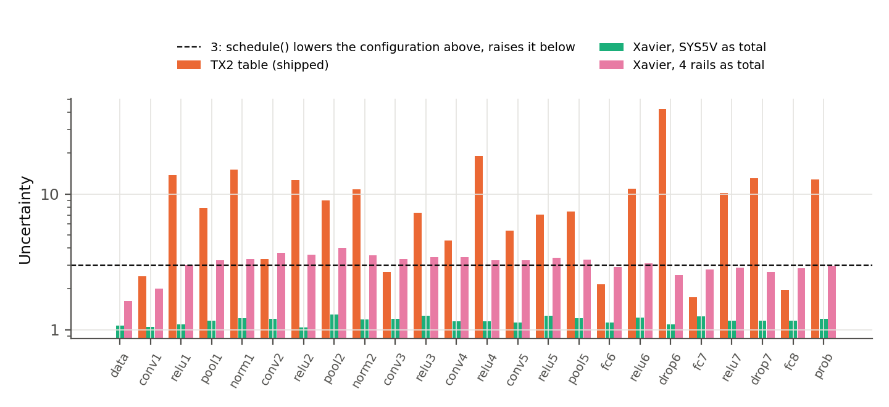
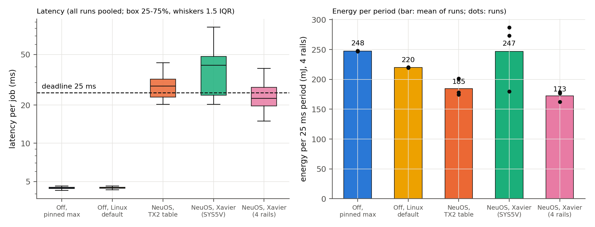

# NeuOS on Jetson AGX Xavier with JetPack 5 (L4T R35.4.1)

This folder records a test of whether the original NeuOS code (Caffe fork plus the `AGX/` overlay)
builds and runs on a current Jetson AGX Xavier software stack, and then how it compares with
plain DVFS settings once it has a profile of this board. The NeuOS README says it was tested on
JetPack 4.3 (L4T 32.3.1, CUDA 10.0). Here it runs on JetPack 5.1.2, which brings CUDA 11.4,
cuDNN 8.6 and OpenCV 4.5. The test network is CaffeNet with a 25 ms deadline.

**Summary**

- **It runs.** After porting fixes, NeuOS builds and runs end to end. With DVFS off, its output
  matches stock Caffe exactly (`cat.jpg`: tabby cat 0.3134). Each inference takes 4.46 ms (p50).
- **Five bugs in the AGX DVFS path had to be fixed** before the controller worked as intended:
  1. a file-descriptor leak;
  2. a MHz/Hz unit error that pins the memory clock at its minimum;
  3. a sysfs write order that makes every clock increase fail;
  4. a `config_mode` argument read from the wrong `argv` slot;
  5. an uninitialized period that switches layers to the low-rank model at random when DVFS is off.
- **Profile and hash table.** A per-layer profile of 336 configurations produced a Xavier hash
  table (round 2). With it, NeuOS uses 22% less energy per 25 ms period than Linux' default DVFS
  (172.5 vs 220.0 mJ) and 30% less than clocks pinned at max.
- **But that does not show an advantage for NeuOS.**
  - It misses the 25 ms deadline in 35% of jobs, where both DVFS-off baselines miss none.
  - The miss rate swings from 0% to 97% between runs of the same setup.
  - An estimate from the same profile puts the best *static* configuration that meets the
    deadline at about the same energy (157 mJ in profile terms, about 175 mJ after calibrating
    the profile against a measured run).
  - NeuOS' latency and energy figures leave out its own reconfiguration (core hotplug and sysfs
    writes), which here costs 4-6 s of wall time per job.

Rounds 1 and 2 are single runs per configuration and three runs per method, respectively.
Details and caveats below.

## Setup

| | |
|---|---|
| Board | Jetson AGX Xavier 32 GB (tegra194), NVMe at `/mnt/ssd` |
| Software | L4T R35.4.1 (JetPack 5.1.2), Ubuntu 20.04, kernel 5.10, CUDA 11.4, cuDNN 8.6.0, OpenCV 4.5.4, CMake 3.16.3, g++ 9.4 |
| Caffe deps | conda-forge env on the NVMe: libprotobuf 3.21, glog 0.5, gflags, Boost 1.74, lmdb, leveldb, snappy, HDF5, OpenBLAS. The eMMC root had < 600 MB free, so nothing was installed system-wide |
| Power mode | MAXN, with `jetson_clocks` applied before every run: CPU 2.27 GHz, GPU 1377 MHz, EMC 2133 MHz, all 8 cores online, fan PWM 229 |
| Model | BVLC CaffeNet (`bvlc_reference_caffenet.caffemodel`, sha1 matches `readme.md`) plus its low-rank twin from `models/lowrank/config.json` (rank 8/40/60/100/200 for conv1-5) |
| Input | `examples/images/cat.jpg`, deadline (`period`) 25 ms |
| DVFS configurations | `examples/triangle/all-AGX.config`: 51,968 configurations (29 CPU clocks × 128 core masks × 14 GPU clocks, EMC 2133 MHz in all) |
| Energy | energymon, from four INA3221 rails: SYS5V, GPU, CPU, VDDRQ. The SOC and CV rails are not read |

## Changes

| File | Change | Why |
|---|---|---|
| `src/caffe/layers/cudnn_conv_layer.cpp` | When cuDNN >= 8, choose algorithms with `cudnnGetConvolution*Algorithm_v7`, taking the fastest whose workspace fits the limit | cuDNN 8 removed `cudnnGetConvolution{Forward,BackwardFilter,BackwardData}Algorithm` |
| `cmake/Cuda.cmake` | Read the version from `cudnn_version.h` when it exists | cuDNN 8 moved the version macros; CMake stopped with "cuDNN version >3 is required" |
| `src/caffe/util/io.cpp` | `SetTotalBytesLimit` takes one argument when protobuf >= 3.6 | The two-argument form was removed |
| `src/caffe/util/io.cpp`, `layers/window_data_layer.cpp`, `test/test_io.cpp` | `CV_LOAD_IMAGE_*` → `cv::IMREAD_*` | These constants are gone in OpenCV 4 |
| `energymon/AGX/odroid/energymon-odroid.c` | Read INA3221 voltage and current through hwmon and compute V·I. Same four rails and units (mW); falls back to the old iio files | L4T R35 replaced `ina3221x/.../iio_device/in_powerN_input` with hwmon. Without this every reading failed (`Bad file descriptor`) and energy was 0 |
| `AGX/include/caffe/net.hpp`, `AGX/src/caffe/net.cpp` | Add `is_config_on` and `shutdown_config()`, as in the TX2 code: `warmup()` and the per-layer scheduling are skipped when DVFS is off | `classification.cpp` calls `shutdown_config()`, which the AGX overlay lacked, so `classify.bin` did not compile. Without the guard, `warmup()` indexes an empty configuration table; as root it would write an all-zero configuration to sysfs (CPU cores offline, 0 Hz) |
| `examples/triangle/classification.cpp` | **Bug 4.** Read `config_mode` from `argv[13]` (the 13th argument in the README) instead of `argv[11]` | `argv[11]` is the low-rank prototxt path, so `atoi` returned 0 and DVFS could never be turned on |
| `AGX/include/DVFS/setconfig.h` | **Bug 1.** No fd leaks; every value is written and closed on its own | `setGpuFreq()` leaked one `force_idle` fd per GPU frequency change. After about 60 jobs the process reached the 1024-fd limit (986 open `force_idle` handles), and from then on frequency writes and power reads failed silently. That run is kept in `results/fd_leak_run/` |
| `AGX/include/DVFS/setconfig.h` | **Bug 2.** `setEmcFreq()` treats values below 10^6 as MHz | Every line of `all-AGX.config` sets memory to `2133`, but bpmp's `emc/rate` expects Hz. `warmup()` therefore asked for 2133 Hz, and EMC sat at its 204 MHz floor for the whole run |
| `AGX/include/DVFS/setconfig.h` | **Bug 3.** Write max, min, max, then the target, closing each file before the next | The original wrote through buffered `FILE*`s, and closing them in freq → min → max order is what actually writes to sysfs. On an increase the kernel rejects the new min, because it is above the old max, so the clock stayed one step behind or did not rise at all. The profile sweep showed this directly: every configuration read back the previous one's GPU clock |
| `AGX/include/caffe/net.hpp` | **Bug 5.** Initialize `_peroid` and `_slack` to 0 | In DVFS-off mode `setup_DVFS()` is never called, so `_peroid` held garbage (logs show `_peroid: 7.03386e-18`). It feeds the slack, then the cohort priority, then the decision to run a conv layer with its low-rank twin. In two baseline runs this sent 999 and 45 layer executions to the low-rank model. Those runs are kept in `results/compare/baselines_uninitialized_peroid/` and were rerun |
| `AGX/src/caffe/net.cpp` | Read the shm key files from `$NEUOS_SHM_DIR` (default `/home/nvidia`, as before) | Lets the code run without a `/home/nvidia` directory (README step 7) |
| `AGX/src/caffe/net.cpp` | Per job, also print the energy of each of the four rails (`++++ rails_mj ...`). `NEUOS_PROFILE=1` prints per-layer latency and energy | NeuOS' own energy figure is the SYS5V rail only, and on the Xavier the GPU and CPU are not on that rail. Output only; scheduling is unchanged |
| `examples/triangle/build_xavier.sh` (new) | Builds `classify.bin` with this board's paths | The `Makefile` points at `/media/SSD/...` and `opencv` (not `opencv4`) |

`models/lowrank/lowrank_approx.py` needs pycaffe (Python 2), which this build does not include.
`scripts/make_lowrank_weights.py` does the same per-group SVD split by reading and writing the
caffemodel protobuf directly. It also accepts the old V1 `layers` format of the BVLC CaffeNet
weights.

## Round 1: does it run? (TX2 hash table)

The first runs used the shipped TX2 hash table, because the repository has no AGX table. They
were made before bugs 3 and 5 were found, so NeuOS could lower clocks but mostly not raise them.
They are kept as a record of the bring-up; round 2 supersedes them.


| Run (round 1, single runs) | Jobs | p50 (ms) | p99 (ms) | Over 25 ms | Energy, SYS5V (mJ/job) |
|---|---|---|---|---|---|
| DVFS off (MAXN, clocks pinned) | 199 | 4.55 | 5.42 | 0% | 20.3 |
| DVFS on, EMC as shipped (204 MHz) | 99 | 101.50 | 132.35 | 100% | 252.9 |
| DVFS on, EMC unit fix | 99 | 27.09 | 34.91 | 96% | 91.1 |



The DVFS-off run checks the port. The `classification.cpp` code path with the early `return 0`
removed (`/mnt/ssd/neuos/check` on the board; not committed) prints exactly the scores the Caffe
docs list for this image and model:
0.3134 tabby cat, 0.2380 tiger cat, 0.1235 Egyptian cat, 0.1003 red fox, 0.0715 lynx.

## Round 2: Xavier hash table and comparison

### Profile and hash table

The hash table is one "Uncertainty" value per layer. `hashtables/generate_hashtable.py` builds it
from per-configuration, per-layer latency L and energy E:

```
U[l] = max over configurations c of (E[c,l] / max_c E[.,l]) / (L[c,l] / max_c L[.,l])
```

The repository has no tool that produces the per-layer logs this script reads, so this round adds
`scripts/profile_layers.cpp`:

- It loads CaffeNet once with batch 1, as `classify.bin` does.
- For each configuration it applies the settings with NeuOS' own setters (`setconfig.h`) and checks
  the clocks read back.
- It runs every layer's `Forward` for at least 200 ms, synchronizing the GPU, and records latency
  and the four rails' energy per call.

NeuOS' own per-layer timing (20 calls, no GPU sync) gives 0 mJ for most layers, because the
INA3221 rails update about once per ms. A 0 would make `schedule()` divide by 0.

**Sweep.** 336 configurations: 6 CPU clocks (115, 499, 960, 1421, 1882, 2266 MHz) × 1, 2, 4 or
8 cores × all 14 GPU clocks, with EMC at 2133 MHz as in every configuration. Every configuration's
clocks read back as set. The sweep includes the extremes of each knob, which matters because U is
a maximum over configurations. Raw logs are in `results/profile/`.

`scripts/make_hashtable.py` applies the formula above and writes two tables:

- `hashtables/caffenet-cudnn-HASHTABLE-xavier-sys5v.txt` uses energymon's "total", which in the
  AGX code is the SYS5V rail. On the Xavier the GPU and CPU are not on that rail, so its power
  barely changes with the configuration, and every U comes out at 1.04-1.29.
- `hashtables/caffenet-cudnn-HASHTABLE-xavier-sum4.txt` uses the sum of the four rails. Its U
  values are 1.6-4.0, close to the TX2 table's range for most layers.



How U is used: in `include/triangle/schedule.h`, a layer with U > 3 moves the configuration index
down by 10/U, and a layer with U < 3 moves it up by 100/U. The index runs over the configuration
table sorted by memory clock, then CPU clock, then GPU clock, then core mask (`Net::myCompare`;
the performance ordering `orderof` is commented out). So a step of 3-100 positions mostly changes
which cores are online, sometimes the GPU clock, and almost never the CPU clock. This matches the
clock traces: the CPU clock hardly moves while the online core count changes all the time.

### Comparison

All runs used the code with all five fixes and started from the pinned-max state. Each method ran
3 times: 200 jobs per run with DVFS off, 100 with NeuOS.

- **Energy** is the sum of the four rails, using the same per-job accounting NeuOS uses.
- **Energy per period** adds idle power for the rest of the 25 ms period when a job finishes
  early. For the baselines that is idle power measured in their own state (pinned 6.45 W, Linux
  default 5.09 W). For NeuOS it is the default-state idle power, which favors NeuOS.



| Method | Runs × jobs | p50 latency (ms) | p99 latency (ms) | Jobs over 25 ms, mean (range) | Energy per job, 4 rails (mJ) | Energy per 25 ms period, 4 rails (mJ) | NeuOS' SYS5V figure (mJ/job) |
|---|---|---|---|---|---|---|---|
| DVFS off, clocks pinned at max | 3 × 199 | 4.46 | 4.68 | 0% (0-0) | 115.0 | 247.5 | 19.6 |
| DVFS off, Linux default DVFS | 3 × 199 | 4.46 | 4.82 | 0% (0-0) | 115.4 | 220.0 | 19.7 |
| NeuOS, TX2 table | 3 × 99 | 28.21 | 39.11 | 67% (2-100) | 180.4 | 184.7 | 95.0 |
| NeuOS, Xavier table (SYS5V) | 3 × 99 | 41.14 | 72.18 | 69% (8-100) | 243.3 | 246.7 | 134.4 |
| NeuOS, Xavier table (4 rails) | 3 × 99 | 22.55 | 33.14 | 35% (0-97) | 158.4 | 172.5 | 79.3 |

Per-run numbers are in `results/compare/summary.txt`.

**Best static configuration (estimate).** `scripts/static_oracle.py` searches the profile for the
lowest energy per period among configurations that fit 25 ms (229 of 336 do). The best is
CPU 960 MHz with 2 cores and GPU 420 MHz: 17.7 ms and 157.4 mJ per period in profile terms. The
profile underestimates the pinned run's measured per-period energy by a factor of 1.11; scaling
by the same factor gives about 175 mJ. This is an estimate from per-layer profiles, not a run
(`results/compare/static_oracle.txt`).

### What this shows

- **The Xavier table helps NeuOS, but only when "total" means the board's rails.** With the
  4-rail table, NeuOS has the lowest energy per period of the measured methods: 22% below Linux'
  default DVFS and 30% below pinned clocks. The faithful SYS5V table does worse than the TX2
  table, because every U < 3, so the scheduler only ever pushes the index up.
- **The energy saving comes with deadline misses.** With the 4-rail table, NeuOS runs most jobs
  at 15-40 ms (whisker range) on a network that needs 4.5 ms at full speed. That saves idle power but misses 25 ms in 35% of jobs
  with the best table, against 0% for both baselines. A static configuration picked from the
  same profile meets the deadline at about the same energy (estimate, about 175 mJ). On this
  board and network, NeuOS' per-layer adaptation does not beat simply running at a fixed lower
  clock.
- **Runs are not repeatable.** The same setup gives a 0% miss rate in one run and 97% in the
  next. `warmup()` starts from a random configuration (`srand(time(NULL))`), and the small index
  steps rarely leave the starting CPU clock.
- **Reconfiguration cost is not in the numbers.** NeuOS' per-job latency is the sum of per-layer
  compute times plus `schedule()`. It leaves out applying the configuration, which here means
  CPU hotplug and sysfs writes before many layers. In wall time a NeuOS job took 4.8-6.9 s, of
  which only 0.4-1.0 s is the 20 repeated layer executions. Under a real 25 ms period this
  per-layer reconfiguration could not run at all, and its energy is not counted either.

So, on this board, these results do **not** show an advantage for NeuOS. What would change that:

- a periodic real-time run that charges the reconfiguration time and energy;
- a measured (not estimated) static-configuration baseline;
- the paper's multi-DNN concurrency scenario (`parallel.sh`), which these runs do not exercise;
- other networks.

### Things not done

- Only CaffeNet and only one instance at a time; no `parallel.sh`.
- No accuracy measurement. In round 2 NeuOS used the low-rank model only in its warmup job
  (5 conv layers per run), so all methods ran the full model afterwards.
- The profile sweep covers 336 of 51,968 configurations.
- The SOC and CV rails are not read, so "4 rails" is not whole-board power.
- The prediction printout in `classification.cpp` still comes after `return 0`.

## Board state

Every script that changes DVFS settings first saves the board state (`jetson_clocks --store`
and `--show`, plus the modes of every file `enable-dvfs.sh` makes writable). Afterwards it
restores governors, cores, clocks, fan PWM and file modes, and compares the result with the
saved state.

- **Round 1.** `jetson_clocks --restore` left EMC and the GPU at NeuOS' last setting twice, and
  the board was put back by hand.
- **Since then.** The scripts open the min/max ranges first and fall back to `jetson_clocks`.
  Every round 2 run restored cleanly (`results/compare/dvfs_run_*.out`).
- **Aborted sweeps.** Two profile sweeps were stopped part-way: one when bug 3 showed up, one
  for speed. After each, the board was restored by hand and checked against the saved state.

After the last run the board matched its pre-run state: MAXN, `schedutil`/`nvhost_podgov`, all
cores online, CPU 2.27 GHz, GPU 1377 MHz, EMC 2133 MHz, fan PWM 229. NeuOS' SysV shm segments
were removed.

## Files

| Path | Content |
|---|---|
| `scripts/build.sh` | Full build: conda deps, energymon, AGX overlay, Caffe, `classify.bin`, CaffeNet weights, low-rank weights |
| `scripts/make_lowrank_weights.py` | Low-rank caffemodel without pycaffe |
| `scripts/profile_layers.cpp`, `scripts/profile_sweep.sh` | Per-layer profiler and the 336-configuration sweep |
| `scripts/make_hashtable.py` | Hash table from the profile (`--total sys5v` or `sum4`) |
| `scripts/dvfs_run.sh` | One NeuOS DVFS-on run: save state, `enable-dvfs.sh`, sample clocks, run, restore. Paths are those used on the board (`/mnt/ssd/neuos`) |
| `scripts/compare.sh` | Round 2: baselines, idle power, and NeuOS with each table |
| `scripts/plot_results.py`, `scripts/plot_compare.py`, `scripts/static_oracle.py` | Figures and tables in this README |
| `hashtables/` | The two Xavier tables and per-layer summaries |
| `results/*.log`, `results/fd_leak_run/` | Round 1 |
| `results/profile/` | Round 2 profile: one log per configuration |
| `results/compare/` | Round 2 comparison logs, clock traces, idle power, board state; `baselines_uninitialized_peroid/` holds the baseline runs affected by bug 5 |

DVFS off:

```bash
sudo env NEUOS_SHM_DIR=/path/to/shm/dir ./classify.bin \
  models/bvlc_reference_caffenet/deploy.prototxt models/bvlc_reference_caffenet/bvlc_reference_caffenet.caffemodel \
  data/ilsvrc12/imagenet_mean.binaryproto data/ilsvrc12/synset_words.txt examples/images/cat.jpg \
  200 25 5 all-AGX.config xavier-jetpack5/hashtables/caffenet-cudnn-HASHTABLE-xavier-sum4.txt \
  models/lowrank/caffenet_lowrank_deploy.prototxt models/lowrank/caffenet_lowrank.caffemodel 0
```

Give absolute paths. Set the last argument to `1` for DVFS on, after running `power-utility/AGX/enable-dvfs.sh` as root.
